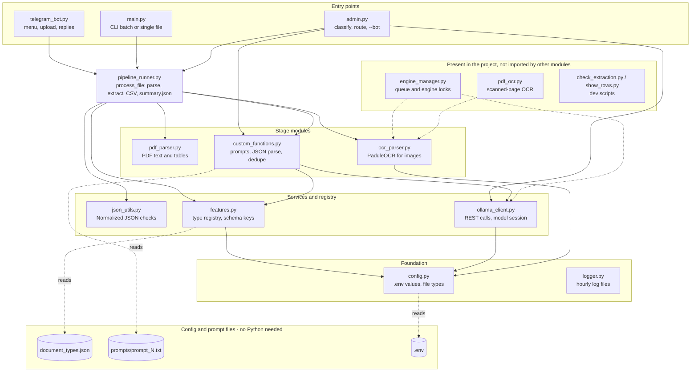
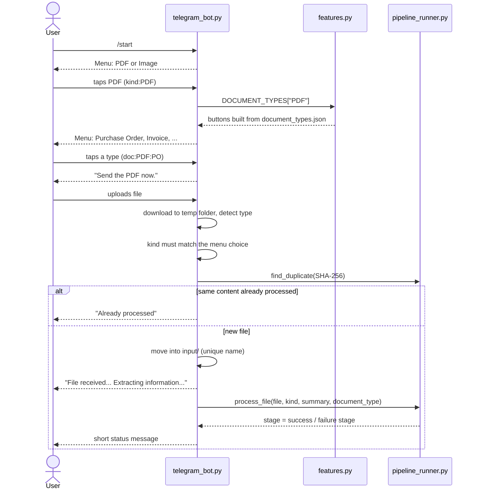
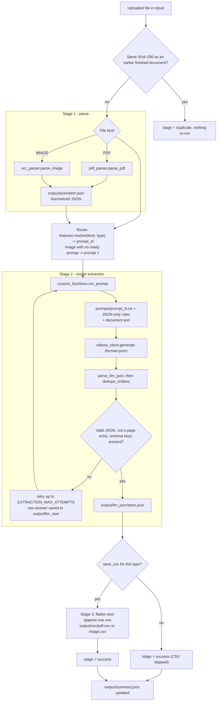
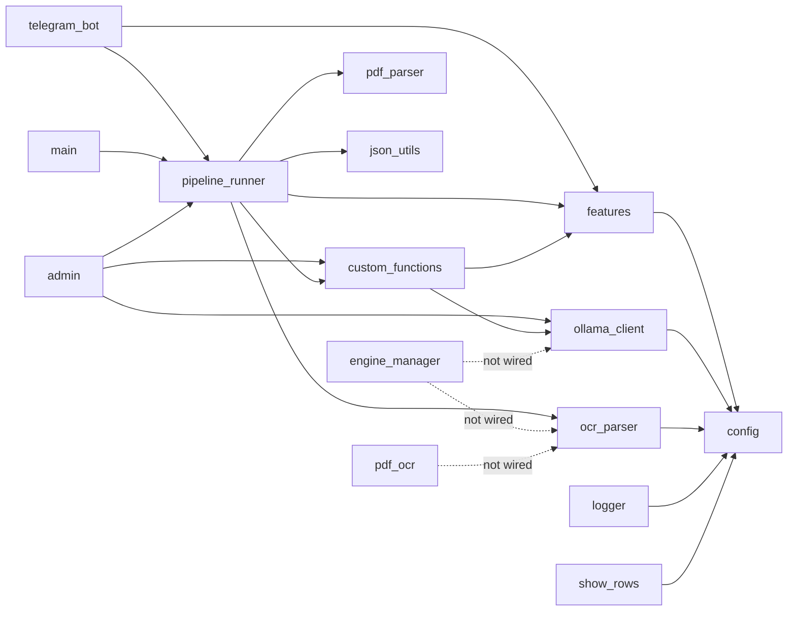
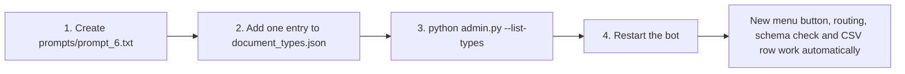

# Document Intelligence Pipeline (Telegram Bot)
 
A multipurpose Telegram bot that turns uploaded **PDFs and images** (purchase orders, work orders, invoices, business cards, ...) into **structured CSV rows**, using a **local** LLM served by [Ollama](https://ollama.com) and **PaddleOCR** for images. Nothing is sent to a cloud API.
 
```
Telegram upload  ->  parse / OCR  ->  Normalized JSON  ->  Ollama (local LLM)  ->  validated JSON  ->  output/csv/*.csv
```
 
New document types are added **only by editing `document_types.json` and adding a file under `prompts/`**. No Python changes are needed.
 
---
 
## Table of contents
 
1. [Features](#features)
2. [Architecture](#architecture)
3. [Telegram interaction flow](#telegram-interaction-flow)
4. [Processing pipeline and data flow](#processing-pipeline-and-data-flow)
5. [Project structure](#project-structure)
6. [Module reference (every Python file)](#module-reference-every-python-file)
7. [Installation](#installation)
8. [Configuration (`.env`)](#configuration-env)
9. [Usage](#usage)
10. [`document_types.json` reference](#document_typesjson-reference)
11. [Adding a new document type (JSON + prompt only)](#adding-a-new-document-type-json--prompt-only)
12. [Compatibility rules](#compatibility-rules)
13. [What needs Python changes](#what-needs-python-changes)
14. [Output files](#output-files)
15. [Known issues](#known-issues)
16. [Troubleshooting](#troubleshooting)
17. [Security](#security)
---
 
## Features
 
| Feature | Implemented in |
|---|---|
| Two-level Telegram menu (PDF / Image, then document type); a tapped menu locks to the chosen button | `telegram_bot.py` |
| Menu buttons generated from configuration, so adding a type needs no code | `features.py`, `document_types.json` |
| PDF text-layer parsing and table detection | `pdf_parser.py` |
| Image OCR with PaddleOCR | `ocr_parser.py` |
| Local LLM extraction through Ollama with a fixed context window | `ollama_client.py`, `custom_functions.py` |
| Duplicate detection by file **content** (SHA-256), not file name | `pipeline_runner.py` |
| Idempotent stages: a valid earlier output is reused, so a failed file can simply be re-sent | `pipeline_runner.py` |
| Answer validation: invalid JSON, echoed page text and wrong schema are rejected and retried | `pipeline_runner.py` |
| Duplicate line-item removal | `custom_functions.py` |
| One flattened row per document in `pdf.csv` / `image.csv` | `pipeline_runner.py` |
| Per-document status in `summary.json` | `pipeline_runner.py` |
| Hourly log files with automatic retention, admin-only `/clear_logs` | `logger.py`, `telegram_bot.py` |
| CLI: batch run, single file, keyword + LLM classifier, `--list-types`, `--test-ollama` | `main.py`, `admin.py` |
| Extraction regression check against a known PO | `check_extraction.py` |
 
---
 
## Architecture
 
Three entry points share one orchestrator. Configuration lives in plain files that need no Python edits.
 

 
---
 
## Telegram interaction flow
 
The **user picks the document type from a menu**. The bot never guesses it; only `admin.py` (CLI) classifies.
 

 
---
 
## Processing pipeline and data flow
 
`pipeline_runner.process_file()` runs three stages. Each stage saves its output and is **skipped on re-run if a valid output already exists**.
 

 
Possible `stage` values returned to the caller: `success`, `duplicate`, `parse_failed`, `empty_ocr`, `unsupported`, `unavailable`, `extract_failed`.
 
---
 
## Project structure
 
```
.
├── telegram_bot.py        # Telegram front end
├── main.py                # CLI: batch / single file / Ollama test
├── admin.py               # CLI: classification + routing, --bot launcher
├── pipeline_runner.py     # process_file(): the three stages
├── custom_functions.py    # prompt loading, JSON parsing, dedupe, run_prompt
├── ollama_client.py       # Ollama REST client
├── features.py            # document-type registry (reads document_types.json)
├── config.py              # .env settings, file-type detection
├── json_utils.py          # JSON helpers + Normalized JSON validation
├── pdf_parser.py          # PDF -> Normalized JSON
├── ocr_parser.py          # image -> PaddleOCR -> Normalized JSON
├── pdf_ocr.py             # OCR for scanned PDF pages (not wired in yet)
├── engine_manager.py      # job queue + engine sessions (not wired in yet)
├── logger.py              # hourly log files + retention
├── check_extraction.py    # regression check for one reference PO
├── show_rows.py           # print line-item rows from pdf.csv
├── document_types.json    # document types (single source of truth)
├── prompts/
│   ├── prompt_1.txt       # business card / general fields
│   ├── prompt_2.txt       # purchase / work order
│   └── prompt_5.txt       # invoice (and any prompt you add)
├── requirements.txt
├── .env                   # secrets and settings (never commit)
├── input/                 # created automatically
├── output/                # created automatically
└── logs/                  # created automatically
```
 
---
 
## Module reference (every Python file)
 
### Entry points
 
| File | Purpose | Imports |
|---|---|---|
| `telegram_bot.py` | Telegram bot (long polling). Handlers: `/start`, `/clear_logs` (admins only), kind menu, type menu, file upload, "process another". Downloads to a temp folder first, checks type, kind and duplicate, then calls `process_file()`. All user-facing text is defined as constants at the top. | `config`, `features`, `logger`, `pipeline_runner` |
| `main.py` | CLI. `python main.py` batch-processes `input/` with a prompt id; `--input FILE --type KEY` processes one file; `--test-ollama`; `--clear-logs`. | `config`, `features`, `logger`, `ollama_client`, `pipeline_runner` |
| `admin.py` | CLI "smart front door": parses a file, **classifies** it (single type, then keyword score, then Ollama, then default), selects the prompt, and calls `process_file()`. Also `--list-types`, `--classify-only`, `--no-llm`, `--bot`. | `config`, `custom_functions`, `features`, `logger`, `ollama_client`, `pipeline_runner` |
 
### Core pipeline
 
| File | Purpose | Key functions |
|---|---|---|
| `pipeline_runner.py` | Orchestrator for one document: SHA-256 duplicate check, Stage 1 parse/OCR, routing, Stage 2 extraction with retries and validation, Stage 3 CSV, `summary.json` tracking. Also the batch loop `run_pipeline()`. | `process_file`, `run_pipeline`, `find_duplicate`, `find_reusable_llm`, `prompt_fingerprint`, `append_document_to_csv`, `_flatten`, `_looks_like_page_echo`, `_schema_problem` |
| `custom_functions.py` | Prompt building and result cleaning. Loads `prompts/prompt_N.txt`, appends the JSON-only rules, puts document text after the instructions, calls Ollama at low temperature, parses the answer, removes duplicate entities. | `load_prompt`, `build_full_prompt`, `build_text_prompt`, `run_prompt`, `parse_llm_json`, `dedupe_entities` |
| `ollama_client.py` | Plain `requests` client for a local Ollama server: `/api/version`, `/api/tags`, `/api/generate`, `/api/ps`. Retry rules, timeouts, automatic `num_ctx` sizing, optional model session (fixed context window, keep-alive), preload and unload. Never downloads a model. | `generate`, `check_ollama`, `check_model`, `model_exists`, `preload_model`, `unload_model`, `begin_session` / `end_session` |
| `features.py` | Document-type registry. Reads `document_types.json` at import, registers prompts, builds `DOCUMENT_TYPES` (menu) and `UNAVAILABLE` (hidden types and the reason). Falls back to built-in PO + Card types if the JSON is invalid. | `reload`, `resolve`, `get`, `saves_to_csv`, `load_types_file`, `apply_types_config` |
| `config.py` | Loads `.env`, defines every setting with a safe default, folder paths, supported file types, `detect_file_type()`, `ensure_directories()`, `validate_config()`. | `detect_file_type`, `validate_config` |
| `json_utils.py` | Read/write JSON and validate the **Normalized JSON** schema (`source_file`, `source_type`, `pages[]`, ...). | `read_json_file`, `write_json_file`, `validate_normalized` |
 
### Parsers
 
| File | Purpose |
|---|---|
| `pdf_parser.py` | PDF to Normalized JSON with PyMuPDF: text per page, table detection, scanned-page flag. **See [Known issues](#known-issues): the uploaded copy is fully commented out.** |
| `ocr_parser.py` | Image to Normalized JSON with PaddleOCR 3.x (falls back to the 2.x API). The engine is created lazily, cached, and released with `release_ocr()`. Output noise from PaddleOCR is silenced. |
| `pdf_ocr.py` | Renders scanned PDF pages with PyMuPDF and reads them with PaddleOCR. **Not imported by any module yet.** |
 
### Support
 
| File | Purpose |
|---|---|
| `logger.py` | One application logger. Writes `logs/YYYY-MM-DD/HH.log`, switches file every hour, deletes day folders older than `LOG_RETENTION_DAYS`, provides `clear_logs()`. |
| `engine_manager.py` | Designed to run OCR and the LLM one after the other: exclusive engine sessions, a single FIFO job queue, a cross-process file lock, and model unloading. **Not imported by any module yet**, so it is currently inactive. |
| `check_extraction.py` | Compares one extraction result with the values read from a reference Adani PO (`4503061061`). Prints PASS/FAIL per field; exit code 0 means all checks passed. |
| `show_rows.py` | Prints the line-item rows of `output/csv/pdf.csv` per document, with a sum check against the PO price. |
 
### Dependency summary
 

 
---
 
## Installation
 
**Prerequisites:** Python 3.10+, [Ollama](https://ollama.com) installed and running, a Telegram bot token from [@BotFather](https://t.me/BotFather).
 
```bash
git clone https://github.com/<your-username>/<your-repo>.git
cd <your-repo>
 
python -m venv .venv
# Windows: .venv\Scripts\activate      Linux/macOS: source .venv/bin/activate
pip install -r requirements.txt
 
ollama pull gemma4:latest        # or any model you set in OLLAMA_MODEL
```
 
`requirements.txt` installs `python-dotenv`, `requests`, `PyMuPDF`, `Pillow`, `paddlepaddle`, `paddleocr` and `python-telegram-bot`. PaddleOCR downloads about 100 MB of models on first use.
 
Create a `.env` file (see below), then check the setup:
 
```bash
python main.py --test-ollama
python admin.py --list-types
```
 
---
 
## Configuration (`.env`)
 
Every value has a default; only the Telegram token is required for the bot.
 
| Key | Default | Meaning |
|---|---|---|
| `TELEGRAM_BOT_TOKEN` | *(empty)* | Bot token. **Required** for the bot. |
| `TELEGRAM_ADMIN_IDS` | *(empty)* | Comma-separated Telegram user IDs allowed to use `/clear_logs`. Empty means nobody. |
| `OLLAMA_HOST` | `http://127.0.0.1:11434` | Ollama URL. `0.0.0.0` is rewritten to `127.0.0.1`. |
| `OLLAMA_MODEL` | `gemma4:latest` | Model used for extraction. |
| `OLLAMA_TIMEOUT` | `300` | Seconds to wait for one model call. |
| `MAX_RETRIES` | `1` | Retries for transient Ollama connection / 5xx errors. |
| `OLLAMA_NUM_CTX` | `16384` | Base context window (tokens). Doubled automatically for long prompts. `0` uses Ollama's default (not recommended). |
| `OLLAMA_MAX_NUM_CTX` | `32768` | Upper limit for the context window. Lower both if you run out of RAM/VRAM. |
| `EXTRACTION_MAX_ATTEMPTS` | `2` | Total model runs per document when the **answer** is unusable. |
| `INPUT_DIR` | `input` | Where accepted uploads are saved. |
| `JSON_DIR` | `output/json` | Normalized JSON files. |
| `LLM_JSON_DIR` | `output/llm_json` | Validated model results. |
| `LLM_RAW_DIR` | `output/llm_raw` | Raw rejected model answers (troubleshooting). |
| `CSV_DIR` | `output/csv` | `pdf.csv` and `image.csv`. |
| `LOG_DIR` | `logs` | Log folder. |
| `LOG_LEVEL` | `INFO` | Use `DEBUG` only when troubleshooting. |
| `LOG_RETENTION_DAYS` | `30` | Day folders older than this are deleted. |
 
Used only by the modules that are not wired in yet: `OLLAMA_SESSION_KEEP_ALIVE` (`10m`), `OLLAMA_UNLOAD_VERIFY_SECONDS` (`15`), `ENGINE_LOCK_TIMEOUT` (`3600`), `OCR_SCANNED_PDF` (`1`), `OCR_PDF_DPI` (`200`).
 
Relative folder paths are resolved against the project folder.
 
Example `.env`:
 
```env
TELEGRAM_BOT_TOKEN=123456:ABC-your-token
TELEGRAM_ADMIN_IDS=111111111
OLLAMA_HOST=http://127.0.0.1:11434
OLLAMA_MODEL=gemma4:latest
OLLAMA_NUM_CTX=16384
```
 
---
 
## Usage
 
### Telegram bot
 
```bash
python telegram_bot.py
# or:  python admin.py --bot
```
 
Send `/start`, pick **PDF** or **Image**, pick the document type, then upload the file. The bot replies with short status messages only.
 
### Command line
 
```bash
python main.py                                   # every file in input/ with prompt 1
python main.py --prompt 2                        # every file with prompt 2
python main.py --input input/po.pdf --type PO    # one file as a given type
python main.py --test-ollama                     # check Ollama and the model
python main.py --clear-logs                      # delete stored logs
 
python admin.py                                  # classify + extract every file in input/
python admin.py --input file.pdf                 # one file, type detected automatically
python admin.py --input file.pdf --type PO       # skip classification
python admin.py --input file.pdf --classify-only # classify only
python admin.py --no-llm                         # keywords only, never ask Ollama
python admin.py --list-types                     # configured types and their status
```
 
### Helper scripts
 
```bash
python check_extraction.py "output/llm_json/<file>.json"   # compare against the reference PO
python show_rows.py                                         # all line-item rows
python show_rows.py "guwahati"                              # only files whose name contains the text
```
 
---
 
## `document_types.json` reference
 
```json
{
  "min_keyword_score": 2,
  "sample_chars": 3500,
  "defaults": { "IMAGE": "Card" },
  "types": {
    "PO": {
      "label": "Purchase Order",
      "description": "A buyer's order sent to a supplier",
      "prompt_id": 2,
      "applies_to": ["PDF"],
      "keywords": ["purchase order", "po number"]
    }
  }
}
```
 
| Field | Used by | Meaning |
|---|---|---|
| `label` | bot | Button text. |
| `description` | `admin.py` | Shown to the LLM classifier. |
| `prompt_id` | bot, runner | Number of `prompts/prompt_<id>.txt`. `null` means not available yet. |
| `applies_to` | bot | `["PDF"]`, `["IMAGE"]` or both. |
| `keywords` | `admin.py` | Lower-case phrases counted by the keyword classifier. |
| `required_keys` | runner | Top-level keys the answer must contain (**at least half** must be present). Applies to prompt ids 5 and up. |
| `text_input` | custom_functions | `true` (default): the model receives plain page text. |
| `save_csv` | runner | `true` (default): append the result to the CSV. |
| `min_keyword_score`, `sample_chars`, `defaults` | `admin.py` only | Classifier tuning; the Telegram bot ignores them. |
| `show_unavailable` | bot | `true` shows types without a ready prompt as "not available yet". |
 
A type whose prompt file is missing is **hidden** from the menu and listed by `python admin.py --list-types`.
 
---
 
## Adding a new document type (JSON + prompt only)
 

 
1. **Create the prompt** `prompts/prompt_6.txt` (use an id of **5 or higher**). Describe the output schema with exactly the keys you will list in `required_keys`, and the extraction rules. The code appends the JSON-only rules and the document text for you.
2. **Add the entry** to `document_types.json`:
```json
   "QUOT": {
     "label": "Quotation",
     "description": "A seller's price offer",
     "prompt_id": 6,
     "applies_to": ["PDF"],
     "keywords": ["quotation", "quote no", "valid until"],
     "required_keys": ["quote_number", "seller", "buyer", "line_items", "totals"]
   }
```
3. **Validate** with `python admin.py --list-types`. It reads the file strictly and fails loudly on a mistake.
4. **Restart** the bot. The type appears in the menu.
---
 
## Compatibility rules
 
- **Use prompt ids 5 and up.** Ids 1-4 have fixed settings in `features.py`; reusing id 2 for a non-PO document would enforce the PO keys and reject valid answers.
- **Validate the JSON before restarting.** A broken `document_types.json` makes `features.py` fall back to the built-in types (PO and Card only) and the menu shrinks. The error is logged.
- **Type keys:** at most 40 characters, no `:`, and not `Unknown`.
- **All PDF types share `pdf.csv`.** Different schemas widen the header and leave blank cells. Set `"save_csv": false` for a type you do not want there.
- **Re-testing the same file reports "duplicate".** Editing a prompt does not re-extract a document that is already in the CSV. Test with a different file, or remove its entry from `output/summary.json` and its row from the CSV.
- **Keyword overlap only affects `admin.py`.** For example `gstin` and `hsn` appear in both POs and invoices; the Telegram bot is not affected because the user selects the type.
---
 
## What needs Python changes
 
These cannot be done through JSON and prompt files alone, because the behavior is defined in code:
 
| Need | Why |
|---|---|
| New file kinds such as DOCX or XLSX | `config.detect_file_type()` and the PDF/Image top-level menu are fixed. |
| A separate CSV per document type | `pipeline_runner.csv_path_for()` returns only `pdf.csv` or `image.csv`. |
| New output channels (database, webhook, email) | Stage 3 only writes CSV. |
| Per-type reply messages or custom validation beyond key presence | Messages and checks are global. |
| Custom duplicate-line-item keys for new list names | `DEDUP_LIST_FIELDS` is fixed (unlisted lists fall back to exact-match dedupe). |
 
---
 
## Output files
 
| Path | Content |
|---|---|
| `input/` | Accepted uploads. |
| `output/json/<stem>.json` | Normalized JSON (pages, text, tables). Internal; reused on re-runs. |
| `output/llm_json/<stem>.json` | Validated model result with `parsed_json`, model name and prompt fingerprint. |
| `output/llm_raw/` | Raw answers of rejected attempts. |
| `output/csv/pdf.csv`, `image.csv` | One flattened row per document (`source_file` plus dotted columns such as `client.company_name`, `line_items.0.quantity`). |
| `output/summary.json` | Status per document: parse, routing, model, CSV, hash, errors. |
| `logs/YYYY-MM-DD/HH.log` | Application log. |
 
---
 
## Known issues
 
1. **`pdf_parser.py` is fully commented out in this upload.** `pipeline_runner` calls `pdf_parser.parse_pdf()`, so PDFs fail at Stage 1 until the file is restored (uncomment it). Image processing is not affected.
2. **`engine_manager.py` and `pdf_ocr.py` are not imported anywhere.** The processing queue, cross-process lock, model unloading and scanned-PDF OCR are inactive. Meanwhile `process_file()` runs inline in the async Telegram handler, so files are processed one at a time and the bot is busy during extraction.
3. **Scanned PDFs** (no text layer) are not OCR'd until `pdf_ocr.py` is connected.
---
 
## Troubleshooting
 
| Symptom | Likely cause and fix |
|---|---|
| "Processing failed" on every PDF | See Known issue 1. |
| Menu shows only PO and Card | `document_types.json` is invalid. Run `python admin.py --list-types`. |
| A new type is missing from the menu | Its `prompts/prompt_<id>.txt` does not exist (the type is hidden). |
| "Could not connect to Ollama" | Start Ollama (`ollama serve`) and check `OLLAMA_HOST`. |
| "Model ... not found" | Run `ollama pull <model>`; models are never downloaded automatically. |
| Garbage or incomplete JSON from the model | The prompt may be truncated. Look for the "likely TRUNCATED" warning in the log and raise `OLLAMA_MAX_NUM_CTX` (needs RAM/VRAM). |
| Timeouts | Raise `OLLAMA_TIMEOUT`; large documents on CPU can take many minutes. |
| "CSV write failed" | `pdf.csv` is open in Excel. Close it and re-send the file; only the CSV step re-runs. |
| "Already processed" for a file you changed | Content hash matches an earlier file. See Compatibility rules. |
 
---
 
## Security
 
- **Never commit `.env`** (it holds the bot token). Add it to `.gitignore`.
- Do not commit real customer documents. Uploaded files and generated outputs belong in `input/` and `output/`, which should be ignored too.
Suggested `.gitignore`:
 
```gitignore
.env
.venv/
__pycache__/
input/
output/
logs/
```
 
---
 
## License
 
Add a license of your choice (for example MIT) before publishing.
